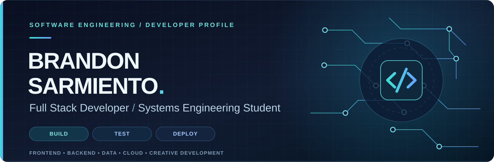

<div align="center">



<br />

**Diseño interfaces. Construyo lógica. Conecto datos. Entrego software que funciona.**

<br />

<a href="https://github.com/Shuaibyh?tab=repositories"></a>


</div>

---

## `01.`  Perfil profesional

Soy **Brandon Sarmiento**, estudiante de **Ingeniería de Sistemas en la Universidad Nacional de Cañete (Perú)**, con enfoque en **desarrollo Full Stack** e interés en construir productos digitales completos: desde la experiencia visual hasta la lógica de negocio, los datos y la puesta en producción.

Trabajo con tecnologías modernas, aprendo mediante la implementación y busco que cada solución sea **comprensible, funcional, mantenible y verificable**. Me interesa tanto lo que ve el usuario como lo que ocurre detrás: arquitectura, validaciones, persistencia, seguridad, pruebas y despliegue.

> **Mi enfoque:** entender el problema antes de escribir código; diseñar con propósito, implementar con criterio y mejorar con evidencia.

## `02.`  Áreas de ingeniería

<table>
<tr>
<td width="50%" valign="top">

### 🎨 Frontend & Experience

Interfaces responsive, componentes reutilizables, accesibilidad y experiencias visuales interactivas.

</td>
<td width="50%" valign="top">

### ⚙️ Backend & APIs

Servicios web, reglas de negocio, validaciones, integración de sistemas y control de acceso.

</td>
</tr>
<tr>
<td valign="top">

### 🗄️ Data & Persistence

Modelado relacional, consultas SQL, persistencia de información y migraciones de base de datos.

</td>
<td valign="top">

### ☁️ Delivery & Cloud

Git, automatización de verificaciones, configuración de entornos y despliegues web.

</td>
</tr>
<tr>
<td valign="top">

### 🧊 Interactive 3D

Visualización en tiempo real, escenas WebGL y experiencias educativas en tres dimensiones.

</td>
<td valign="top">

### 🧪 Software Quality

Pruebas, revisión de código, documentación y mejora continua de aplicaciones.

</td>
</tr>
</table>

## `03.`  Tecnologías y herramientas

<sub>Herramientas utilizadas en proyectos y prácticas. Su presencia aquí no implica el mismo nivel de dominio en todas.</sub>

**INTERFACES & FRONTEND**

      

**BACKEND & SERVICIOS**

    

**BASES DE DATOS & PERSISTENCIA**

   

**CALIDAD, HERRAMIENTAS & DESPLIEGUE**

      

**VISUALIZACIÓN INTERACTIVA**

 

<details>
<summary><b>Profundizando actualmente</b></summary>
<br />

Seguridad con Spring Security, estrategias de autenticación y autorización, pruebas de integración, observabilidad, arquitectura escalable e integración responsable de IA. **Son áreas en aprendizaje, no especializaciones que afirme dominar.**

</details>

## `04.`  Mi forma de construir software

```text
  ENTENDER           DISEÑAR           CONSTRUIR           VALIDAR           ENTREGAR
     01  ──────────►   02   ──────────►    03    ──────────►   04    ──────────►   05
  Problema           Modelo            Código             Pruebas           Despliegue
  y contexto         y solución        e integración     y revisión        y evolución
```

Me importa que una aplicación no solo se vea bien: también debe tener un flujo coherente, una arquitectura entendible y un comportamiento que pueda comprobarse.

## `05.`  Colaboración y crecimiento

- **Trabajo en equipo:** participación en iniciativas tecnológicas universitarias, desarrollo colaborativo y revisión de cambios.
- **Comunicación y organización:** experiencia en representación estudiantil y coordinación de actividades académicas.
- **Aprendizaje continuo:** práctica con sistemas web, ingeniería de software, diseño de interfaces, infraestructura y herramientas de IA.
- **Criterio técnico:** documentación del estado real del software, incluidos sus límites y oportunidades de mejora.

## `06.`  Enfoque actual

<div align="center">

| Ingeniería de software | Calidad y seguridad | Evolución técnica |
| :---: | :---: | :---: |
| Arquitectura Full Stack | Autenticación y pruebas | Sistemas escalables e IA responsable |

</div>

Estoy desarrollando mis capacidades para aportar en equipos de **Full Stack Development, Software Development y Web Engineering**, especialmente en oportunidades de nivel **Junior** y modalidad **remota**.

---

<div align="center">

### Explore the work. Understand the thinking.

**El código, la documentación y la evolución técnica están en los repositorios.**

<a href="https://github.com/Shuaibyh?tab=repositories"></a>
<a href="https://github.com/Shuaibyh"></a>

<sub>Brandon Sarmiento · Chincha, Perú · Systems Engineering Student</sub>

</div>
